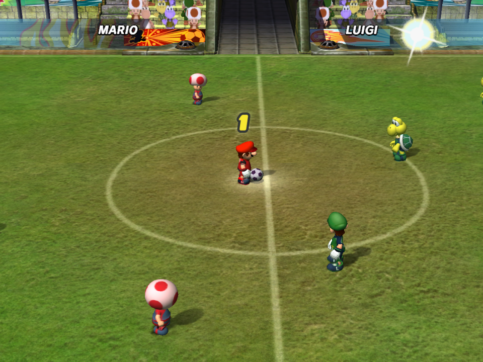

# OpenStrikers

A native PC port of **Super Mario Strikers**, built from the game's
[decompilation](https://github.com/yannicksuter/smstrikers-decomp) and
[Aurora](https://github.com/encounter/aurora). It runs the game's C++ on the
host, with SDL3 and WebGPU/Dawn providing the platform layer.

**Bring your own disc image.** No game data is included.

## Play on Windows

Start with the **[Windows play guide](docs/PLAYING-WINDOWS.md)**. It covers
building from source, launching a copy someone has built, controls, local
multiplayer, online matches and troubleshooting.

If you already have a build:

1. Extract the whole folder, keeping the DLLs and launcher files together.
2. Open `launcher\OpenStrikersLauncher-win32-x64\OpenStrikersLauncher.exe`
   inside that folder.
3. In **Settings**, choose your uncompressed `.iso` or `.gcm` disc image and
   `openstrikers.exe`, then select **Play**.

When building from this repository, enable `OPENSTRIKERS_AUDIO=ON` for sound;
the Windows guide includes that option.

## What works

- Full matches, menus, replays, movies, memory-card saves and controller or
  keyboard input.
- Music, crowd, sound effects and stadium reverb in audio-enabled builds.
- An Electron launcher with display settings, local player names, online
  lobbies and co-op cups.
- Network matches for up to eight computers, with up to four local players
  per computer and eight human-controlled fielders in total.

Windows UCRT64 is the tested build path. A two-PC LAN match was verified on
2026-10-15. Linux has built and booted, but has not been rechecked since the
rendering and input changes. Internet hosting needs a reachable host; there
is no relay service. See [current issues and limits](ISSUES.md).

## Documentation

| I want to... | Read |
|---|---|
| Get into a game on Windows | [Windows play guide](docs/PLAYING-WINDOWS.md) |
| Build on Linux, change build options or maintain patches | [Building and patching](docs/BUILDING.md) |
| Run checks, capture frames or investigate a crash | [Testing and debugging](docs/DEVELOPMENT.md) |
| Use terminal netplay or understand synchronization | [Network play reference](docs/NETPLAY.md) |
| Understand the host layer and porting constraints | [Architecture and porting reference](docs/ARCHITECTURE.md) |
| Find past fixes and session notes | [Archive](docs/archive/README.md) |

Current instructions live in the guides above. Keep reproduced problems in
[ISSUES.md](ISSUES.md) and historical investigations in the archive.
